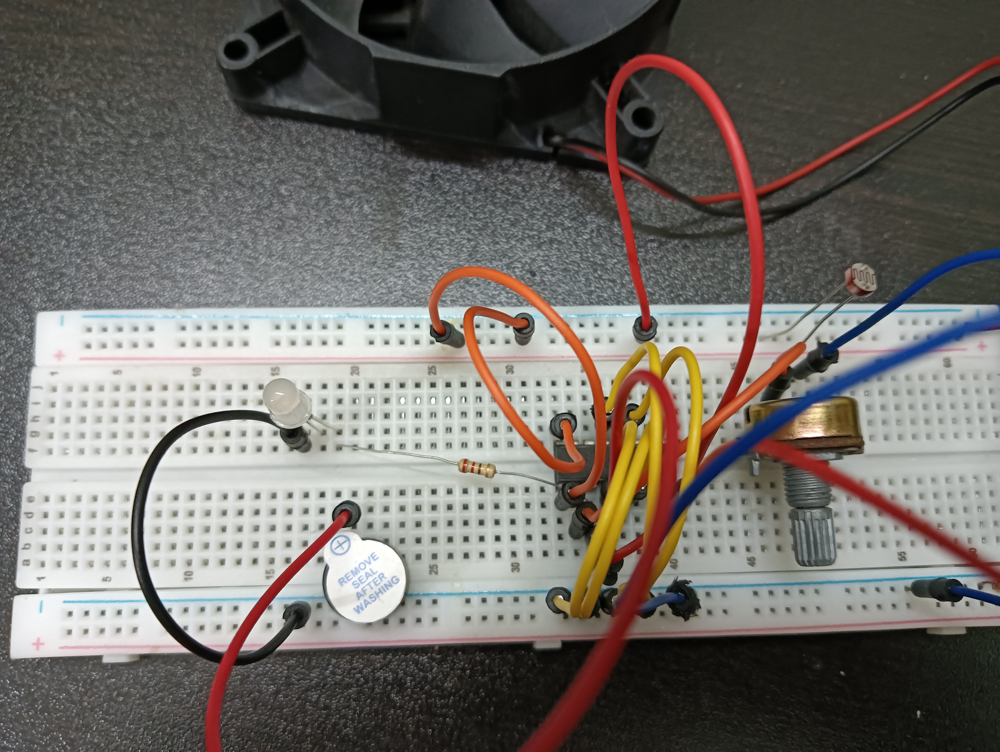
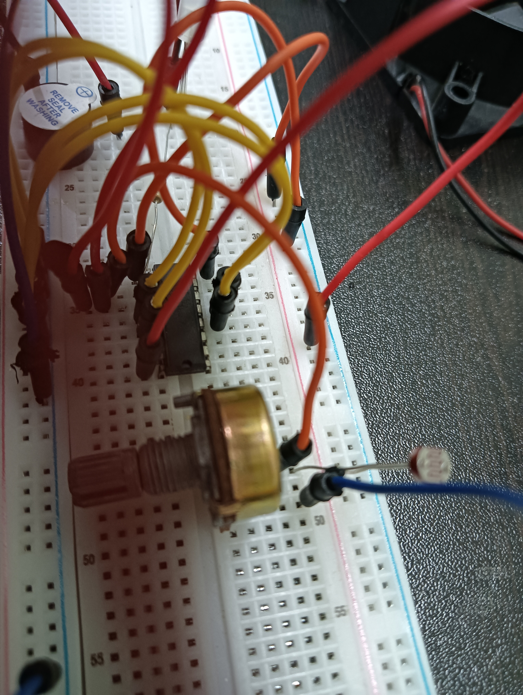
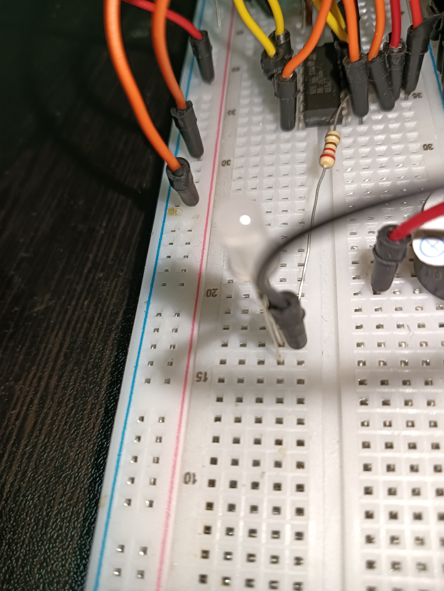
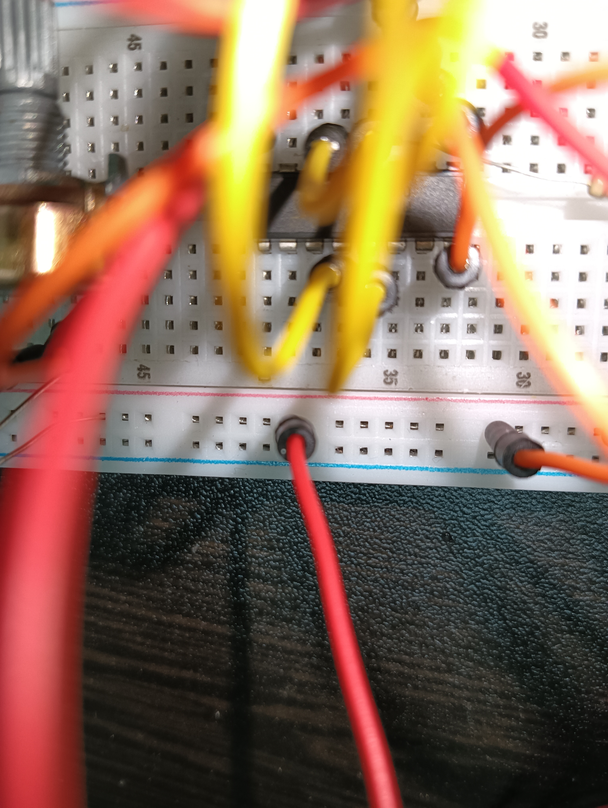
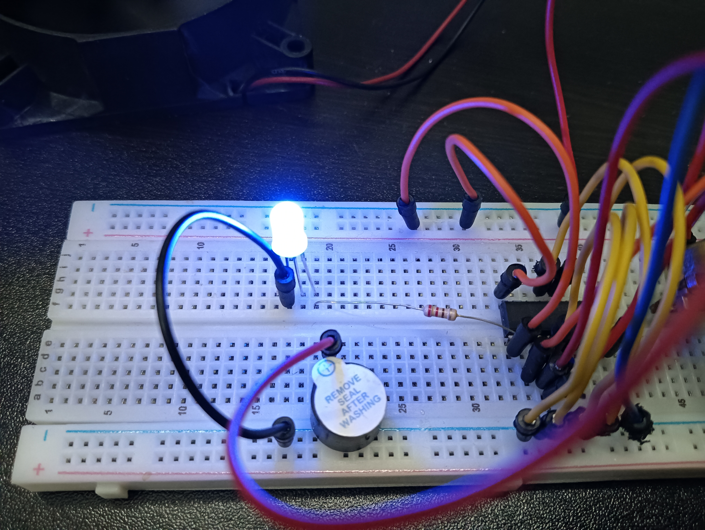
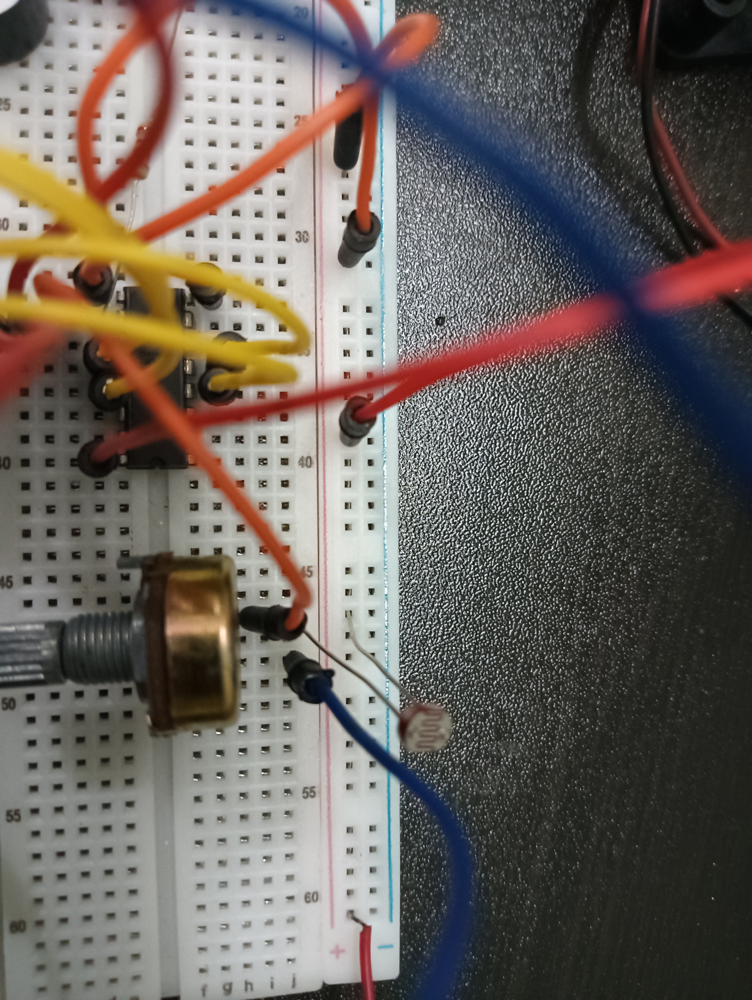
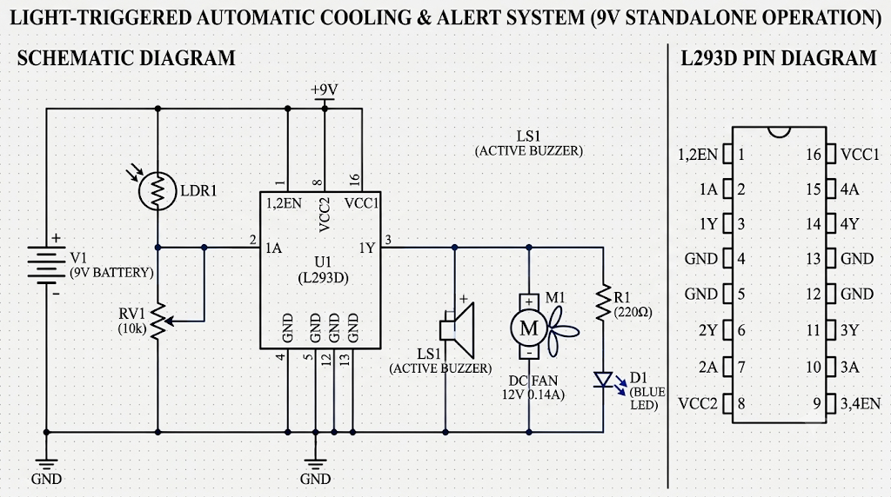

# Analog-project
# Analog Circuit Project

## Overview
Brief explanation of what the circuit does and how it operates.

## Components Used
* **IC:** L293D Motor Driver
* **Potentiometer:** 10kΩ
* **Power Supply:** 9V DC
* **LDR sensor:**
* * **Dc fan** 
## Pin Diagram & Connections
| Component Pin | Connected To | Notes |
| :--- | :--- | :--- |
| Pin 1 (Enable 1,2) | +9V / Potentiometer Wiper | Controls motor speed |
| Pin 2 (Input 1) | +9V Rail | Sets forward direction |
| Pin 3 (Output 1) | DC Motor (+) | Motor terminal A |
| Pin 4, 5 , 12 , 13 (GND) | Common Ground (-) | Heat sink & ground |
| Pin 8 (Vcc) | +9V Rail | For driving motor |
| Pin 16 (Logic gate) | +9V Rail | always the IC to work
You can use  a led and an active buzzer too
## Breadboard Setup

## Components Used
* **IC:** L293D Quadruple Half-H Driver
* **Sensors:** Light Dependent Resistor (LDR), $10\text{ k}\Omega$ Potentiometer
* **Output Loads:** $12\text{V}$ DC Cooling Fan, Active Buzzer, Blue LED, $220\ \Omega$ Resistor
* **Power:** $9\text{V}$ DC Battery

## L293D Pin Connections (Notch Facing Down — Channel 3)
Because the L293D is oriented with its notch facing down, Channel 3 (`3A` $\rightarrow$ `3Y`) is used:

| Breadboard Position | L293D Pin | Pin Name | Connection |
| :--- | :--- | :--- | :--- |
| Bottom-Right | Pin 1 | `1,2EN` | $+9\text{V}$ Rail |
| Top-Right | Pin 8 | `VCC2` (Motor Supply) | $+9\text{V}$ Rail |
| Top-Left | Pin 9 | `3,4EN` (Channel 3/4 Enable) | $+9\text{V}$ Rail |
| 2nd from Top-Left | Pin 10 | `3A` (Sensor Input) | LDR + Potentiometer Junction |
| 3rd from Top-Left | Pin 11 | `3Y` (Driver Output) | Fan (+), Buzzer (+), $220\ \Omega$ Resistor $\rightarrow$ LED (+) |
| Middle Pins | Pins 4, 5, 12, 13 | `GND` / Heat Sink | Common Ground (`0V`) |
| Bottom-Left | Pin 16 | `VCC1` (Logic Supply) | $+9\text{V}$ Rail |

## Working Principle & Design Reasoning

1. **Signal Conditioning (Voltage Divider):**
   An L293D input reads voltage, not resistance. Pairing the LDR ($+9\text{V}$ side) with a $10\text{ k}\Omega$ potentiometer ($\text{GND}$ side) converts changing light resistance into a readable logic voltage ($V_{IN}$):
   $$V_{IN} = 9\text{V} \times \left(\frac{R_{POT}}{R_{LDR} + R_{POT}}\right)$$
   * **Bright Light:** $R_{LDR}$ drops ($\approx 1\text{ k}\Omega$), pushing $V_{IN}$ above the L293D's TTL high threshold ($V_{IH} \ge 2.3\text{V}$) to switch outputs **ON**.
   * **Darkness:** $R_{LDR}$ rises ($\approx 50\text{ k}\Omega$), dropping $V_{IN}$ below $1.5\text{V}$ ($V_{IL}$) to switch outputs **OFF**.
   * **Potentiometer Role:** Calibrates the exact light trigger threshold for different ambient lighting environments.

2. **High-Current Switching & Back-EMF Protection (L293D):**
   The sensor divider supplies $< 1\text{ mA}$, whereas the DC fan requires $\approx 150\text{ mA}$. The L293D acts as a power buffer and protects the circuit from inductive motor spikes upon shutoff via its built-in internal clamp diodes.

3. **Parallel Output Loads & LED Current Limiting:**
   All loads are wired in parallel so each receives the full output voltage ($\approx 7.2\text{V}$ after the L293D's internal Darlington drop). A $220\ \Omega$ resistor limits the Blue LED current ($V_F \approx 3.1\text{V}$) to safe levels:
   $$R = \frac{9\text{V} - 3.1\text{V}}{0.02\text{A}} = 295\ \Omega \rightarrow 220\ \Omega\text{ (standard value)}$$
