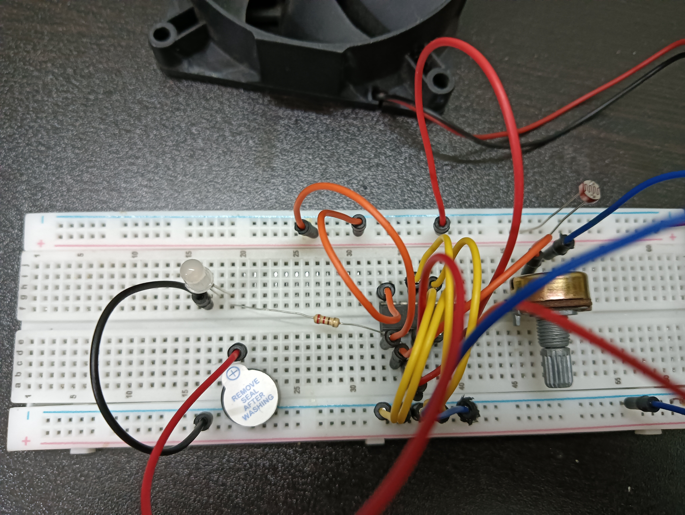

# Analog-project
# Analog Circuit Project

## Overview
Brief explanation of what the circuit does and how it operates.

## Components Used
* **IC:** L293D Motor Driver
* **Potentiometer:** 10kΩ
* **Power Supply:** 9V DC
* **LDR sensor:**
* * **Dc fan** 
## Pin Diagram & Connections
| Component Pin | Connected To | Notes |
| :--- | :--- | :--- |
| Pin 1 (Enable 1,2) | +9V / Potentiometer Wiper | Controls motor speed |
| Pin 2 (Input 1) | +9V Rail | Sets forward direction |
| Pin 3 (Output 1) | DC Motor (+) | Motor terminal A |
| Pin 4, 5 , 12 , 13 (GND) | Common Ground (-) | Heat sink & ground |
| Pin 8 (Vcc) | +9V Rail | For driving motor |
| Pin 16 (Logic gate) | +9V Rail | always the IC to work
You can use  a led and an active buzzer too

